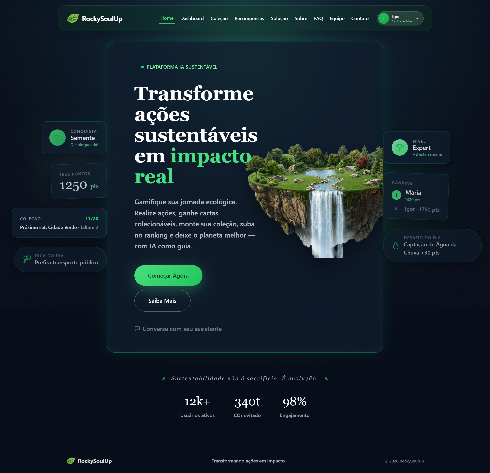
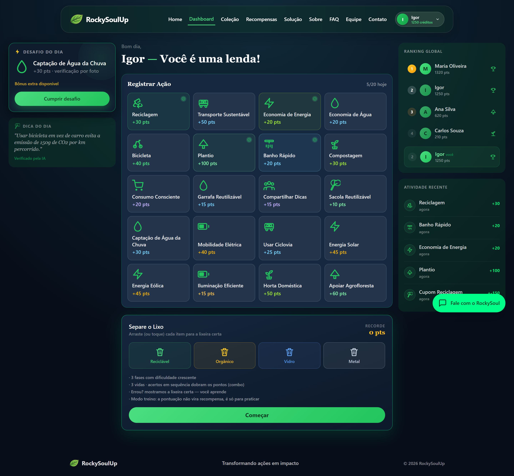
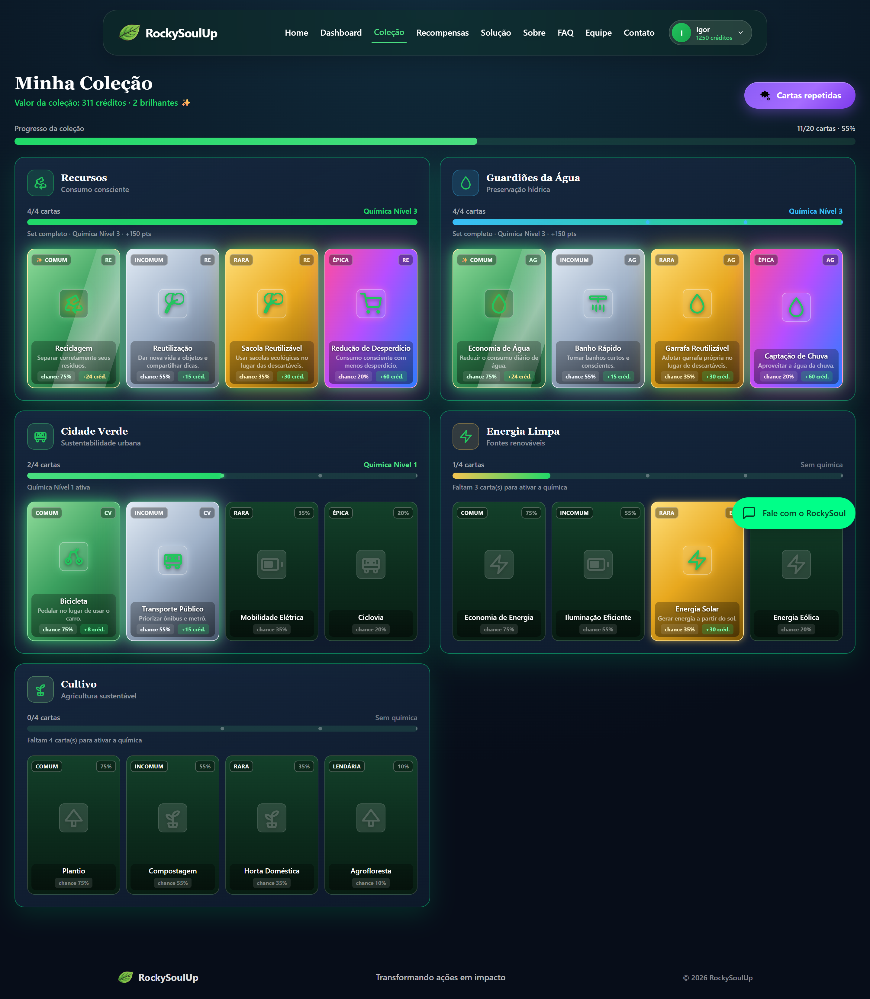
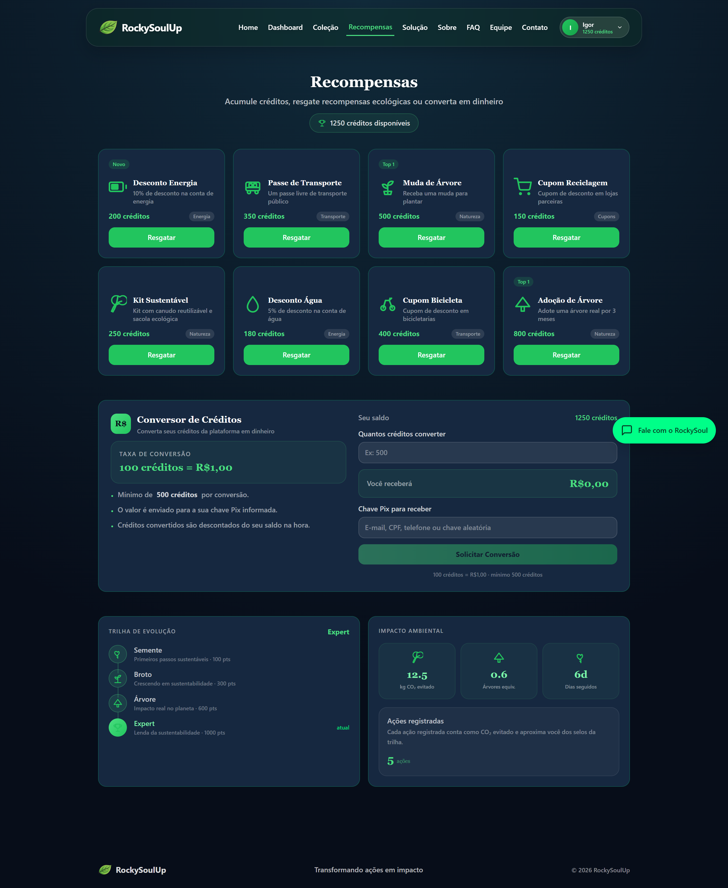

# RockySoulUp — Frontend React

<p align="center">
  
</p>

Plataforma **gamificada** de sustentabilidade que transforma ações ecológicas do dia a dia em **pontos, níveis, selos, cartinhas colecionáveis, mini-jogos e recompensas reais** — com integração a um **avatar inteligente** (o assistente **RockySoul**) que guia a jornada do usuário dentro do site.

Desenvolvida como **SPA (Single Page Application)** com **React + Vite + TypeScript + TailwindCSS**.

---

## Imagens e Ícones do Projeto

As principais telas da plataforma (Home, Dashboard, Coleção e Recompensas):

<table align="center">
  <tr>
    <td align="center">
      <br>
      <sub><strong>Home</strong> — vitrine e o assistente RockySoul</sub>
    </td>
    <td align="center">
      <br>
      <sub><strong>Dashboard</strong> — pontos, nível, selos e desafio do dia</sub>
    </td>
  </tr>
  <tr>
    <td align="center">
      <br>
      <sub><strong>Coleção</strong> — cartinhas, sets e Fábrica de Cartas</sub>
    </td>
    <td align="center">
      <br>
      <sub><strong>Recompensas</strong> — troca de pontos por prêmios</sub>
    </td>
  </tr>
</table>

---

## Gamificação com Avatar Integrado

O coração do projeto é a combinação de **gamificação** com um **avatar/assistente virtual** que media toda a experiência dentro do site:

- **Avatar RockySoul** — assistente virtual integrado ao site. Ele conversa em português, entende comandos de linguagem natural ("reciclei", "usei bicicleta", "economizei água") e executa ações reais na aplicação: registra ações, mostra saldo/nível, sugere missões, ensina curiosidades e até resgata recompensas para o usuário.
- **Pontos** — cada ação sustentável gera pontos que alimentam o avatar e o perfil do usuário.
- **Níveis de evolução** — Broto → Semente → Árvore → Floresta, com progresso visual em anel de progresso e barra de XP.
- **Selos desbloqueáveis** — conquistas automáticas ao acumular pontos.
- **Coleção de Cartinhas** — ao concluir missões, uma **roleta** sorteia **cartinhas colecionáveis** de 5 sets temáticos e 5 raridades (Comum a Lendária), com chance de versão **brilhante** ✨. Cartas repetidas viram **fragmentos** para a **Fábrica de Cartas**, e completar um set (4/4) ativa a **química** com bônus de até +180 créditos (+30 na 3ª carta e +150 na 4ª).
- **Mini-jogo "Separe o Lixo"** — gamificação extra por meio de um jogo de separação de recicláveis (3 fases, vidas, combos e recordes), em modo treino: a pontuação não vira recompensa, serve para praticar e se divertir.
- **Desafio do Dia** — missão diária com bônus por streak (dias seguidos).
- **Ranking global** — posição do usuário entre os participantes da comunidade.
- **Recompensas reais** — troca de pontos por cupons, descontos e brindes na página Recompensas.
- **Conversor de créditos em dinheiro** — converte créditos em reais que são enviados pela sua **chave Pix** (100 créditos = R$ 1,00, mínimo de 500 créditos).
- **Impacto ambiental** — métricas de CO₂ evitado e árvores equivalentes.

O assistente **RockySoul** funciona como um "avatar" que representa o site: ele interage com o usuário, conhece o progresso dele (via estado global) e o acompanha em cada página — reforçando o laço entre gamificação e a interface.

---

## Tecnologias Utilizadas

- **React 19** — Interface e componentização
- **Vite** — Build, dev server e desempenho
- **TypeScript** — Tipagem estática obrigatória
- **TailwindCSS 4** — Estilização utilitária de toda a interface
- **React Router DOM 7** — Navegação SPA com rotas estáticas e dinâmicas
- **Oxlint** — Linter

> Sem frameworks de UI prontos (Bootstrap, Material UI, Chakra, jQuery etc.) e sem bibliotecas externas de requisição (como Axios). Toda a interface, gamificação e o chat do avatar são **100% código próprio** em React + Vite + TypeScript.

---

## Páginas e Rotas

| Rota | Página | Tipo |
| --- | --- | --- |
| `/` | Home | Estática |
| `/dashboard` | Dashboard (gamificação + avatar) | Estática |
| `/colecao` | Coleção de Cartinhas + Fábrica de Cartas | Estática |
| `/solucao` | Solução do Projeto | Estática |
| `/recompensas` | Recompensas | Estática |
| `/recompensas/:id` | Detalhe da Recompensa | **Dinâmica (useParams)** |
| `/parceiros` | Parceiros e Ecopontos | Estática |
| `/sobre` | Sobre | Estática |
| `/faq` | FAQ | Estática |
| `/integrantes` | Equipe | Estática |
| `/contato` | Contato | Estática |
| `/*` | Página 404 (endereços desconhecidos) | Estática |

---

## Estrutura de Pastas

```
rockysoul-react/
├── public/
│   ├── icons/                  # Icones SVG da aplicacao
│   └── imagens/                # Logo, ilha, prints das telas e fotos dos integrantes
├── src/
│   ├── components/             # Componentes reutilizaveis
│   │   ├── Header.tsx          # Navegacao principal + menu do usuario
│   │   ├── Footer.tsx          # Rodape do site
│   │   ├── Chat.tsx            # Avatar RockySoul (assistente virtual)
│   │   ├── Toast.tsx           # Sistema de notificacoes
│   │   ├── LoginModal.tsx      # Cadastro/entrada com validacao propria
│   │   ├── VerificarModal.tsx  # Verificacao de acao (foto/GPS/timer/declaracao)
│   │   ├── ResgatarModal.tsx   # Confirmacao de resgate de recompensa
│   │   ├── MiniJogoSeparacao.tsx # Mini-jogo de separacao de lixo
│   │   ├── CardItem.tsx        # Cartinha colecionavel (raridade, foil, hover)
│   │   ├── NovaCarta.tsx       # Cartinha revelada depois da roleta
│   │   ├── RoletaDrop.tsx      # Roleta de sorteio da cartinha
│   │   ├── SetColecao.tsx      # Set de cartinhas com quimica
│   │   ├── SetProgress.tsx     # Barra de progresso do set
│   │   ├── CartaFabricarModal.tsx # Fabricacao de carta com fragmentos
│   │   ├── PainelValorColecao.tsx # Resumo e guia de valores da colecao
│   │   ├── TrilhaEvolucaoModal.tsx # Trilha de niveis e bonus
│   │   ├── TermoAjuda.tsx      # Tooltip de ajuda
│   │   ├── IconeMissao.tsx    # Icone de missao/carta
│   │   ├── IlhaRockySoul.tsx  # Ilha animada da Home
│   │   └── OnboardingTutorial.tsx # Tutorial inicial
│   ├── pages/                  # Paginas da aplicacao (componentes React)
│   │   ├── Home.tsx
│   │   ├── Dashboard.tsx
│   │   ├── Colecao.tsx         # Colecao de cartinhas + Fabrica de Cartas
│   │   ├── Solucao.tsx
│   │   ├── Recompensas.tsx
│   │   ├── RecompensaDetalhe.tsx  # Rota dinamica com useParams
│   │   ├── Sobre.tsx
│   │   ├── Faq.tsx
│   │   ├── Integrantes.tsx
│   │   └── Contato.tsx
│   ├── context/        # Estado global (DataContext, CollectionContext, ChatContext)
│   ├── hooks/          # Hooks personalizados (useLocalStorage, useChemistry, useLoginGate)
│   ├── data/           # Dados e constantes (missoes, selos, niveis, recompensas, cartas, integrantes)
│   ├── types/          # Interfaces TypeScript
│   ├── layouts/        # LayoutPrincipal (Header + Outlet + Footer)
│   ├── utils/          # Formatacao, validacao, limpeza de dados e login
│   ├── App.tsx         # Rotas e layout principal
│   ├── main.tsx        # Ponto de entrada
│   └── index.css       # Tailwind + tema (cores, fontes) + animacoes
```

---

## Sistema de Gamificação

### Níveis e Selos

| Nível | Faixa de Pontos | Selo correspondente |
| --- | --- | --- |
| Broto | 0 – 499 | Broto (0 pts) |
| Semente | 500 – 1.199 | Semente (500 pts) |
| Árvore | 1.200 – 1.999 | Árvore (1.200 pts) |
| Floresta | 2000+ | Floresta (2.000 pts) |

### Missoes (ações sustentáveis)

São **20 missões** — Reciclagem, Transporte Sustentável, Economia de Energia, Economia de Água, Bicicleta, Plantio, Banho Rápido (timer), Compostagem, Consumo Consciente, Garrafa Reutilizável, Compartilhar Dicas, Sacola Reutilizável, Captação de Água da Chuva, Mobilidade Elétrica, Usar Ciclovia, Energia Solar, Energia Eólica, Iluminação Eficiente, Horta Doméstica e Apoiar Agrofloresta — cada uma com pontuação própria e formato de **comprovação** (foto, foto+GPS, timer ou declaração).

### Coleção de Cartinhas

Ao concluir uma missão, o Dashboard aciona a **roleta** e pode premiar você com uma cartinha. São **20 cartinhas** divididas em **5 sets temáticos** — Recursos, Guardiões da Água, Cidade Verde, Energia Limpa e Cultivo — com **Química** de set: complete 4 cartinhas de um set para ganhar **+180 créditos** (+30 na 3ª e +150 na 4ª). Cada raridade tem sua própria chance de ser sorteada e rende fragmentos diferentes quando repetida:

| Raridade | Chance de encontrar | Fragmentos por repetida |
| --- | --- | --- |
| Comum | 75% | +3 |
| Incomum | 55% | +5 |
| Rara | 35% | +10 |
| Épica | 20% | +20 |
| Lendária | 10% | +40 |

Há ainda **8% de chance** de a cartinha vir na versão **brilhante** (✨). Na **Fábrica de Cartas** (aba dentro da página Coleção), fragmentos são usados para montar cartinhas que faltam — custo de 10/16/32/70/140 fragmentos por raridade (Comum/Incomum/Rara/Épica/Lendária).

### Recompensas

**12 recompensas** — descontos de energia/água, passes de transporte, mudas, adoção de árvores, cupons e kits sustentáveis — resgatáveis conforme o saldo de créditos. A página também traz o **Conversor de Créditos** (100 créditos = R$ 1,00, mínimo de 500, pagamento via **chave Pix**) e os painéis de **Trilha de Evolução** e **Impacto Ambiental** (CO₂ evitado e árvores equivalentes).

### Ranking global

Além do seu saldo, o app simula a comunidade com o **Ranking global** (Maria Oliveira, Ana Silva, Carlos Souza e Pedro Santos) para posicionar o usuário entre os participantes.

---

## Avatar RockySoul (Assistente Virtual)

O **Chat.tsx** implementa o avatar inteligente com:

- **Detecção de intenção** via palavras-chave em português (saudação, pontos, nível, dica, recompensa, registro de ação, curiosidade, despedida etc.).
- **Fluxos guiados** (registrar ação, converter créditos e resgatar recompensa) com entrada numérica.
- **Integração com o estado global** (`DataContext` e `CollectionContext`): o avatar acessa pontos, nível, histórico e coleção de cartinhas, e realiza ações reais (adicionar/subtrair pontos, registrar resgates).
- **Sugestões rápidas** e **curiosidades sustentáveis**.
- Teaser inicial que convida o usuário a conversar com o assistente (`ChatContext`).

---

## Como Usar

### 1. Instalação e execução

```bash
# Clone o repositório
git clone https://github.com/igorodriguesd/rockysoul-react.git
cd rockysoul-react

# Instale as dependencias
npm install

# Inicie o servidor de desenvolvimento
npm run dev

# Gere a build de producao
npm run build

# Rode o linter
npm run lint
```

Acesse `http://localhost:5173` no navegador (porta padrão do Vite).

### 2. Uso da plataforma

1. Na **Home**, clique em **"Começar Agora"** e informe seu nome/email.
2. No **Dashboard**, registre uma ação sustentável (reciclar, economizar energia/água, usar transporte etc.), envie a foto como comprovação e acumule **pontos**.
3. Cada missão concluída aciona a **roleta**: conquiste **cartinhas colecionáveis** e monte sua coleção na página **Coleção** — completando sets você ativa a **química** (+180 créditos).
4. Complete o **Desafio do Dia** para ganhar bônus e mantenha o **streak** (dias seguidos).
5. Treine no **Mini-jogo "Separe o Lixo"** para praticar a separação de recicláveis e bater seus recordes (modo treino, sem valer recompensa).
6. Evolua nos **níveis** (Broto → Semente → Árvore → Floresta), desbloqueie **selos** e veja sua posição no **ranking**.
7. Troque seus créditos por **recompensas reais** ou **converta em dinheiro via Pix** na página Recompensas.
8. Converse com o **avatar RockySoul** (canto inferior direito) — ele registra ações, mostra saldo e resgata recompensas por texto.

---

## Responsividade

- **Mobile** — até 480px
- **Tablet** — 768px
- **Desktop** — 992px+

No TailwindCSS, os tokens de breakpoint (`sm`=480px, `md`=768px, `lg`=992px, `xl`=1280px) foram alinhados a esse spec em `src/index.css`, garantindo que o layout não quebre em nenhuma das larguras avaliadas.

---

## Dados Persistidos

Todas as informações do usuário são salvas no **localStorage**, via hook `useLocalStorage`:

- Pontos totais e diários
- Missões completadas
- Histórico de ações
- Selos desbloqueados
- Resgates e conversões
- Dados do usuário (nome/email)
- Streak (dias seguidos) e desafio do dia
- **Coleção de cartinhas** (cartas obtidas, brilhantes, fragmentos e sets)
- Recordes do mini-jogo

Ações de registro de missão, resgate e conversão só são permitidas após informar ao menos o **nome**. Ao sair, o app remove **todas** as chaves `rocky_*` do localStorage e volta ao estado inicial (pontos, cartas, fragmentos, histórico, onboarding e recordes).

---

## Repositório

- **GitHub:** https://github.com/igorodriguesd/rockysoul-react

---

## Integrantes

| Foto | Nome | RM | Turma | GitHub | LinkedIn |
| --- | --- | --- | --- | --- | --- |
|  | Igor Rodrigues de Santana | RM570651 | 1TDSPK | [igorodriguesd](https://github.com/igorodriguesd) | [LinkedIn](https://linkedin.com/in/igor-rodrigues-135aa72b2) |
|  | Diego Gomes Goncalves de Lima | RM570335 | 1TDSPK | [dgxls](https://github.com/dgxls) | [LinkedIn](https://www.linkedin.com/in/diego-gomes-65339b408/) |
|  | Miguel Silva | RM572019 | 1TDSPK | [miguelsilva71](https://github.com/miguelsilva71) | [LinkedIn](https://www.linkedin.com/in/miguel-silva-0a20073a9/) |
|  | Rafael Santos Mendonca Costa | RM572368 | 1TDSPK | [RafaelSantos56](https://github.com/RafaelSantos56) | [LinkedIn](https://www.linkedin.com/in/rafael-santos-b09bba237/) |
|  | Pedro Henrique Salvatore | RM572999 | 1TDSPK | [Pedro-H-Salvatore](https://github.com/Pedro-H-Salvatore) | [LinkedIn](https://www.linkedin.com/in/pedro-salvatore-a4a2763b7) |

**Turma 1TDSPK — FIAP 2026**

---

## Estrutura do Backlog

O projeto utiliza um **backlog Kanban** com 4 colunas para organizar as tarefas por status, seguindo as melhores práticas de gestão visual ágil. Cada item possui **etiquetas** para identificação rápida do tipo de trabalho, módulo e prioridade.

### Colunas do Backlog

| Coluna | Descrição |
|--------|-----------|
| 📋 **Backlogs** | Itens planejados para desenvolvimento futuro, aguardando priorização |
| 📝 **A Fazer** | Itens a serem iniciados no próximo ciclo, já priorizados |
| 🔄 **Em Andamento** | Itens em desenvolvimento ativo pela equipe |
| ✅ **Concluído** | Itens finalizados e entregues com sucesso |

### Sistema de Etiquetas

O projeto utiliza **etiquetas coloridas** no estilo Trello, onde cada card pode ter **múltiplas etiquetas** para identificar diferentes aspectos. As etiquetas são barras coloridas sem texto, permitindo visualização rápida.

#### Cores e Significados

| Cor | Significado | Uso |
|-----|-------------|-----|
| <span style="background:#22c55e;padding:2px 8px;border-radius:4px;color:white">**Verde**</span> | Feature | Nova funcionalidade ou melhoria significativa |
| <span style="background:#3b82f6;padding:2px 8px;border-radius:4px;color:white">**Azul**</span> | Frontend | Tarefas de interface React (componentes, páginas, estilos) |
| <span style="background:#f59e0b;padding:2px 8px;border-radius:4px;color:white">**Amarelo**</span> | Backend | Tarefas de backend Java/Python (APIs, banco, lógica) |
| <span style="background:#a855f7;padding:2px 8px;border-radius:4px;color:white">**Roxo**</span> | IA | Inteligência artificial, machine learning e NLP |
| <span style="background:#ef4444;padding:2px 8px;border-radius:4px;color:white">**Vermelho**</span> | Gamificação | Sistemas de pontos, níveis, cartas e mini-jogos |
| <span style="background:#6b7280;padding:2px 8px;border-radius:4px;color:white">**Cinza**</span> | Docs | Documentação técnica, acadêmica ou de processos |
| <span style="background:#f97316;padding:2px 8px;border-radius:4px;color:white">**Laranja**</span> | Entrega | Tarefas de entrega final (PDF, vídeo, Trello, deploy) |
| <span style="background:#14b8a6;padding:2px 8px;border-radius:4px;color:white">**Teal**</span> | Dados | Datasets e dados para treinamento de IA |
| <span style="background:#ec4899;padding:2px 8px;border-radius:4px;color:white">**Rosa**</span> | Qualidade | Testes, acessibilidade, revisões e validações |
| <span style="background:#ef4444;padding:2px 8px;border-radius:4px;color:white">**Vermelho escuro**</span> | Prioridade Alta | Tarefas críticas que exigem atenção imediata |

#### Como Aplicar

Cada card no Trello deve ter **2 a 4 etiquetas** combinando:
- **1 cor de tipo** (feature, melhoria, bug)
- **1 cor de módulo** (frontend, backend, ia, gamificação)
- **1 cor de prioridade** (vermelho escuro = alta)
- **1 cor opcional** (docs, entrega, qualidade, responsável)

**Exemplo:** Um card "Integrar IA ao Dashboard" teria:
- 🟢 Verde (feature)
- 🟣 Roxo (IA)
- 🔴 Vermelho escuro (prioridade alta)

**Exemplo:** Um card "Compilar PDF Final" teria:
- ⚪ Cinza (docs)
- 🟠 Laranja (entrega)
- 🔴 Vermelho escuro (prioridade alta)

---

## Descrição dos Componentes

### Componentes React (`src/components/`)

| Componente | Arquivo | Descrição |
|------------|---------|-----------|
| **Header** | `Header.tsx` | Navegação principal com 9 links, menu mobile, perfil do usuário com arco de progresso, vitrine de cartas, níveis, créditos e conversão. Inclui dropdown do usuário com opções entrar/sair. |
| **Footer** | `Footer.tsx` | Rodapé com logo, slogan e copyright do projeto. |
| **Chat** | `Chat.tsx` | Assistente virtual RockySoul com detecção de 18 intents de NLP por keywords. Suporta registro de ações, conversão de créditos, resgate de recompensas, dicas e curiosidades. Mantém estado da conversa (aguardando nome, ação, resgate, valor, chave Pix). ~608 linhas. |
| **LoginModal** | `LoginModal.tsx` | Modal de cadastro/login com campos nome (obrigatório, min 3) e email (opcional). Validação em tempo real e persistência no localStorage. |
| **VerificarModal** | `VerificarModal.tsx` | Modal completo de verificação de ação: upload de foto (JPG/PNG/WEBP, max 10MB), GPS opcional, timer countdown (5min), declaração (1x/dia com localStorage). Após confirmar: aciona RoletaDrop, exibe NovaCarta e feedback de drop. ~495 linhas. |
| **ResgatarModal** | `ResgatarModal.tsx` | Modal de resgate de recompensa com validação de saldo, confirmação e feedback de sucesso. |
| **RoletaDrop** | `RoletaDrop.tsx` | Roleta visual animada em SVG com 36 slots que gira por 4.2 segundos. Mostra chance de drop, cores por raridade e resultado predeterminado. |
| **CardItem** | `CardItem.tsx` | Renderiza uma carta colecionável com visual estilo "FUT" (gols, brilho, foil, raridade, chance, valor). Mostra carta bloqueada/desbloqueada. |
| **NovaCarta** | `NovaCarta.tsx` | Exibe animação de nova carta obtida após roleta, com informação de set, química e bônus. |
| **SetColecao** | `SetColecao.tsx` | Renderiza um set de 4 cartas com header, progresso e grid de CardItem. |
| **SetProgress** | `SetProgress.tsx` | Barra de progresso de um set com marcos (nível 1/2/3), texto descritivo e bônus. |
| **CartaFabricarModal** | `CartaFabricarModal.tsx` | Modal para fabricar uma carta usando fragmentos da raridade (custo, quanto falta e valor creditado). |
| **PainelValorColecao** | `PainelValorColecao.tsx` | Resumo da coleção (valor creditado e cartas obtidas) e guia de valores por raridade e por set. |
| **TrilhaEvolucaoModal** | `TrilhaEvolucaoModal.tsx` | Trilha de evolução com níveis, bônus e próximos desbloqueios. |
| **TermoAjuda** | `TermoAjuda.tsx` | Tooltip acessível de ajuda rápida. |
| **IconeMissao** | `IconeMissao.tsx` | Ícone de missão/carta com cor do grupo. |
| **IlhaRockySoul** | `IlhaRockySoul.tsx` | Ilha animada usada na Home. |
| **OnboardingTutorial** | `OnboardingTutorial.tsx` | Tutorial inicial de boas-vindas. |
| **MiniJogoSeparacao** | `MiniJogoSeparacao.tsx` | Mini-jogo educativo de separação de lixo com 3 fases, 3 vidas, combo, drag-and-drop, 4 categorias (reciclável, orgânico, vidro, metal), 16 itens, recordes em localStorage e medalhas. ~518 linhas. Modo treino (não soma recompensa). |
| **Toast** | `Toast.tsx` | Sistema global de notificações toast com auto-dismiss em 2.8 segundos. |

### Páginas React (`src/pages/`)

| Página | Arquivo | Descrição |
|--------|---------|-----------|
| **Home** | `Home.tsx` | Landing page com hero section, ilha flutuante animada, ranking mockado, desafio do dia, dica do dia, stats (12k+ usuários, 340t CO₂, 98% engajamento) e CTAs "Começar Agora" e "Saiba Mais". LoginModal integrado. |
| **Dashboard** | `Dashboard.tsx` | Painel principal: desafio do dia com bônus, dica do dia (IA), grid de 20 missões para registrar, ranking global (com usuário real + 4 simulados), atividade recente (histórico + resgates + conversões) e MiniJogoSeparacao. Abre VerificarModal ao clicar em missão. ~445 linhas. |
| **Coleção** | `Colecao.tsx` | Exibe coleção completa: progresso total, grid de 5 sets (SetColecao) e Fábrica de Cartas em aba própria (cartas faltantes, fragmentos por raridade, custo de fabricação e botão fabricar). |
| **Solução** | `Solucao.tsx` | Página institucional: problema, como funciona (5 passos), coleção de cartas (explicação visual com 5 raridades), sets e química, níveis e selos, diferenciais. |
| **Recompensas** | `Recompensas.tsx` | Catálogo de 12 recompensas (card com badge, link para detalhe, botão resgatar), trilha de evolução (4 níveis), impacto ambiental (CO₂, árvores, streak) e conversor de créditos em dinheiro (Pix com validação, min 500 créditos). ResgatarModal integrado. ~304 linhas. |
| **RecompensaDetalhe** | `RecompensaDetalhe.tsx` | Detalhe de uma recompensa com ícone, badge, categoria, descrição, saldo vs custo e botão resgatar. 404 caso não encontre. |
| **Sobre** | `Sobre.tsx` | Página institucional: descrição do projeto e 8 tecnologias utilizadas (React, TS, Vite, Tailwind, HTML5, IBM Watson, Node-RED, Telegram Bot). |
| **FAQ** | `Faq.tsx` | 14 perguntas frequentes com accordion animado. |
| **Integrantes** | `Integrantes.tsx` | 4 membros da equipe com foto, nome, RM, GitHub e LinkedIn. |
| **Parceiros** | `Parceiros.tsx` | Ecopontos, patrocinadores e vouchers parceiros, com impacto e cortesias. |
| **Contato** | `Contato.tsx` | Formulário de contato (nome, email, mensagem) com validação e feedback de envio. |
| **404** | `PaginaNaoEncontrada.tsx` | Página de erro para rotas não encontradas com link para home. |

### Contextos React (`src/context/`)

| Contexto | Arquivo | Descrição |
|----------|---------|-----------|
| **DataContext** | `DataContext.tsx` | Gerencia dados do usuário: nome, email, pontos, histórico, resgates, selos, streak, desafio do dia e bônus. Persiste automaticamente no localStorage. |
| **CollectionContext** | `CollectionContext.tsx` | Gerencia coleção de cartas: adquirir carta, drop por missão, fragmentos, fabricar carta, química de sets, progresso e valor total. Persiste no localStorage. |
| **ChatContext** | `ChatContext.tsx` | Controla estado aberto/fechado do chatbot. |

### Hooks React (`src/hooks/`)

| Hook | Arquivo | Descrição |
|------|---------|-----------|
| **useChemistry** | `useChemistry.ts` | Calcula química de um set: nível (0-3), percentual, mensagem descritiva e se set está completo. |
| **useLocalStorage** | `useLocalStorage.ts` | Hook genérico de persistência em localStorage; remove a chave quando o valor volta ao padrão (usado no logout). |
| **useLoginGate** | `useLoginGate.ts` | Exige nome do usuário antes de registrar ações e abre o modal de login quando necessário. |

### Dados React (`src/data/`)

| Arquivo | Descrição |
|---------|-----------|
| **constants.ts** | 20 missões sustentáveis (id, nome, pontos, ícone, tipo de comprovação), CO₂ por missão (20 valores), 4 selos/níveis, 12 recompensas, 4 usuários simulados (ranking), 5 curiosidades, 14 perguntas FAQ, 5 integrantes e taxa de conversão (100 créditos = R$1). |
| **cartas.ts** | 20 cartas em 5 sets (4 cartas cada), 5 raridades com chances (75/55/35/20/10%), chance foil (8%), valores por raridade, fragmentos por duplicada, custo de fabricação e função calcularQuímica (nível 1/2/3). |
| **cartasStyle.ts** | Estilos visuais das cartas: backgrounds por raridade (gradientes), glows, tiers (border, glow, texto), funções getCardBackground, getCardLabel, getIniciaisSet e efeito foil. |

### Utils React (`src/utils/`)

| Arquivo | Descrição |
|---------|-----------|
| **validation.ts** | Funções de validação: validateName (min 3, max 50, apenas letras), validateEmail (regex), validateMessage (min 10), normalizeName (trim + lowercase) e normalizeEmail (trim + lowercase). |
| **limparDados.ts** | Remove todas as chaves `rocky_*` do localStorage no logout. |
| **loginGate.ts** | Evento global para abrir o modal de login a partir de qualquer ação bloqueada. |

### Tipos React (`src/types/`)

| Tipo | Descrição |
|------|-----------|
| `Comprovacao` | Union type: foto, foto-gps, timer, declaracao |
| `Missao` | Interface de missão sustentável (id, nome, pontos, ícone, comprovacao, tempoTimer) |
| `Selo`, `Nivel` | Interfaces de selos e níveis |
| `Recompensa` | Interface de recompensa (id, nome, descricao, pontos, categoria, icone, badge) |
| `HistoricoEntrada`, `Resgate` | Interfaces de histórico e resgates |
| `UsuarioSimulado` | Interface de usuários simulados para ranking |
| `ChatMessage` | Mensagem do chat (user/bot) |
| `UserData` | Dados completos do usuário (nome, email, pontos, missoes, streak, etc.) |
| `RaridadeCarta` | Union type: comum, incomum, rara, epica, lendaria |
| `Carta`, `SetCarta`, `Quimica` | Interfaces do sistema de cartas |
| `SetColecaoUsuario`, `ColecaoData` | Interfaces da coleção do usuário |
| `NovaCartaInfo`, `ResultadoDrop` | Tipos para drops e fabricação |

---

## Contato

Para entrar em contato com a equipe RockySoulUp:

- **Formulário do site:** acesse a rota `/contato` da aplicação e envie uma mensagem.
- **GitHub do repositório:** abra uma issue ou PR em https://github.com/igorodriguesd/rockysoul-react
- **LinkedIn dos integrantes:** utilize os links da tabela de **Integrantes** acima para falar diretamente com cada membro da equipe.
